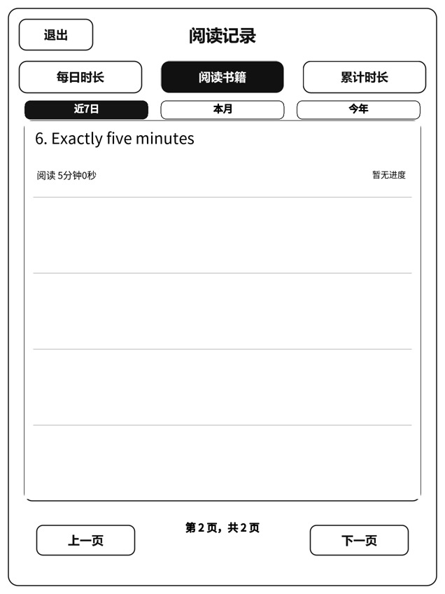
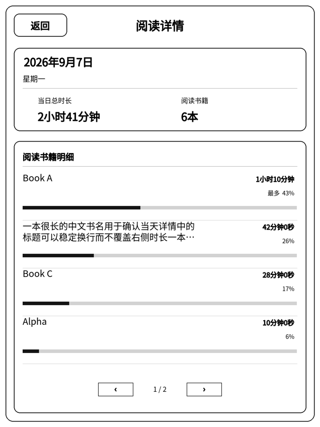

# Kindle 阅读记录

适用于已越狱 Kindle 的本地阅读记录插件。原生阅读器处于前台、屏幕亮起时记录阅读时长，可查看月历热力、每日与累计统计、最近 8 周、阅读书籍、本地封面、月份与单书详情。

当前版本为 **v9.8.1 Standard 普通版**。**5.20 Vera 优先下载 test12 推荐包；5.19 Vera 选择 5.19 专用包。** 安装前需已有可用的 **SH Integration 书库脚本支持**，不适用于 KS（Kindle Scribe）。

## 安装包选择

| 下载 | 何时选择 | 与推荐包的区别 |
|---|---|---|
| **[推荐包｜5.20 Vera · test12](https://github.com/L-1116/kindle-reading-records-enhanced/releases/download/v9.8.1/Kindle-Reading-Records-v9.8.1-5.20-vera-test12-recommended.zip)** | **5.20 Vera 首选**，包括 5.20.1、5.20.1.0.2；KPW6、青春版及 KC 用户均先选推荐包 | 保留蓝牙计时、启动优化和彩色封面修复；安装报告改存内部目录，并修正安装文件时间戳 |
| [5.19 专用包｜Vera](https://github.com/L-1116/kindle-reading-records-enhanced/releases/download/v9.8.1/Kindle-Reading-Records-v9.8.1-5.19-vera-519-only.zip) | **5.19 Vera 使用**；已验收 KPW6／5.19.6／Vera | 独立适配原包，未加入后续 5.20 包的蓝牙与彩色封面修复 |
| [KC 备用包｜5.20 Vera · test11](https://github.com/L-1116/kindle-reading-records-enhanced/releases/download/v9.8.1/Kindle-Reading-Records-v9.8.1-5.20-vera-test11-KC-backup.zip) | **KC 备用**：需要选用此前验收的旧版时选择；安装条件见下文 | 保留彩色封面和蓝牙计时修复；未包含 test12 安装修订 |
| [KPW6／青春版备用包｜5.20 Vera · test10](https://github.com/L-1116/kindle-reading-records-enhanced/releases/download/v9.8.1/Kindle-Reading-Records-v9.8.1-5.20-vera-test10-KPW6-Youth-backup.zip) | **KPW6／青春版备用**：需要选用旧版时选择；安装条件见下文 | 保留蓝牙计时、启动优化和触摸识别修复；未包含彩色封面修复及 test12 安装修订，**不推荐 KC 使用** |

**固件说明：5.20.1 和 5.20.1.0.2 可选择 9.8.1-5.20-vera 系列。** 2026-10-25 用户补充确认 test12 已实机通过，以及 5.20.1.0.2 已有实际安装使用成功；此次未提供具体机型或新固件对应的 test 构建，不据此宣称所有机型、所有固件小版本均已实测。

备用包用于需要选用此前旧版的情况，无需为了设备型号先安装备用包。test10 的青春版备用定位不等于新增 test10 青春版完整实测；既有青春版 2024／5.20.1 的启动验收来自 test9。

## 安装与原地升级

1. **先备份 Kindle 的 `reading-time` 文件夹**，保留阅读历史、配置和封面。
2. 按上表选择 **一个安装 ZIP**。5.20 Vera 优先 test12；5.19 Vera 使用专用包。首次安装需要选用旧版，或推荐包安装失败并已自动恢复旧版本时，可再按设备选择 test11 或 test10 备用包。
3. **只解压外层 ZIP 一次**，得到 `reading-records-v4-install.sh` 与 `阅读记录安装数据.tar`，将两者一起复制到 Kindle `documents`，覆盖同名安装文件；**不要继续解压 TAR，不要混用不同包的脚本和 TAR**。
4. 安全弹出 Kindle，在书库点击“安装阅读记录”，等待完成。旧 Standard 普通版可按相同步骤原地覆盖安装，无需先卸载或删除历史数据。
5. 打开“阅读记录”，确认历史、封面和新增计时正常后，再点击“确认无误之后，再点这个”清理安装文件。

**备用包同样要从该 ZIP 重新复制完整的两份配套文件。已成功安装 test12 的设备，test11／test10 原包会因版本归属保护拒绝直接降级；此时请保留当前安装与数据，通过 Issues 寻求支持，不要手动删除入口或绕过校验。** 清理不是卸载；不要手动清空 `reading-time`。test12 的安装报告与自动安装诊断保存在 `reading-time/install-logs/`，避免进入书库；test10、test11 仍保留旧报告行为。

Assets 中提供四个安装 ZIP，显示名称标明推荐或备用；下载后的文件名以 `recommended` 标注推荐包、`backup` 标注备用包。GitHub 自动生成的 **Source code (zip)** 与 **Source code (tar.gz)** 是源码下载，**不是 Kindle 安装包**。

[详细安装与回滚](docs/安装与回滚.md) · [v9.8.1 发布页](https://github.com/L-1116/kindle-reading-records-enhanced/releases/tag/v9.8.1) · [其他固件与旧版 v9.7.6](https://github.com/L-1116/kindle-reading-records-enhanced/releases/tag/v9.7.6)

## v9.8.1 新功能

- **自定义缺失封面**：支持通用替代图片，也可给每本书指定专属图片；已有可用原始封面继续优先使用。历史书籍以双列卡片显示，并标明当前封面来源。
- **新增设置界面**：在插件内管理计时选项和自定义封面。
- **自定义无操作计时上限**：可设置连续多少分钟无操作后暂停计时（1～1440 分钟）；5.20/Vera 当前包支持触摸与蓝牙翻页恢复，5.19/Vera 原包保持原有触摸行为，减少忘记翻页时的误计时；可单独开关。
- **累计时长与阅读书籍 UI 更新**：调整文字、图表和按钮布局；阅读书籍及历史书籍均可点击底部页码直接跳页，历史书籍每页显示 10 本。
- **修复插件界面无法熄屏的问题**，改善停留在插件内时的休眠与恢复行为。

安装完成后，USB 存储中的 `reading-time/custom-covers/` 图片目录即已存在，无需先启动插件或开启封面开关。把 JPG / PNG 图片复制到该目录，再到“设置 → 自定义缺失封面”启用并选择通用或专属图片。自定义封面与无操作暂停计时初始均关闭，已有设置在升级时保留。

## 界面预览（旧版参考）

| 每日时长 | 阅读书籍 | 当天详情 |
|---|---|---|
|  |  |  |

## 使用支持与历史版本

其他环境请查看 [v9.7.6 原发布页](https://github.com/L-1116/kindle-reading-records-enhanced/releases/tag/v9.7.6)，按该页的固件、越狱方式与安装步骤选择，不将 KPW4 SpringBreak 包扩大为所有 5.18 设备。KS 不适用当前四包。

遇到问题时保留安装文件和备份，通过 [Issues](https://github.com/L-1116/kindle-reading-records-enhanced/issues) 提供机型、固件、越狱方式、所选安装包及错误现象。普通用户无需执行诊断命令、选择 runtime 或测试二进制。

[更新记录](CHANGELOG.md) · [发布说明与封面用法](docs/releases/v9.8.1.md) · [包来源与校验表](docs/releases/v9.8.1-downloads.md) · [全部历史 Releases](https://github.com/L-1116/kindle-reading-records-enhanced/releases)

## 作者、上游授权与致谢

本项目基于 [Plutoill/kindle-reading-records](https://github.com/Plutoill/kindle-reading-records) 的代码，经原作者明确授权后继续维护。原始工作归 Plutoill，后续增强和维护由 L-1116 完成；本仓库不是上游或 Amazon 的官方版本。

本仓库不附加通用软件许可证，也不应被视为向第三方授予复制、修改或再发布代码的许可；如需复用，请分别联系相关权利人。随包 NotoSansCJK 字体按 SIL Open Font License 1.1 分发，条款见 [FONT-LICENSE.txt](native-reading-time-package/FONT-LICENSE.txt)。
