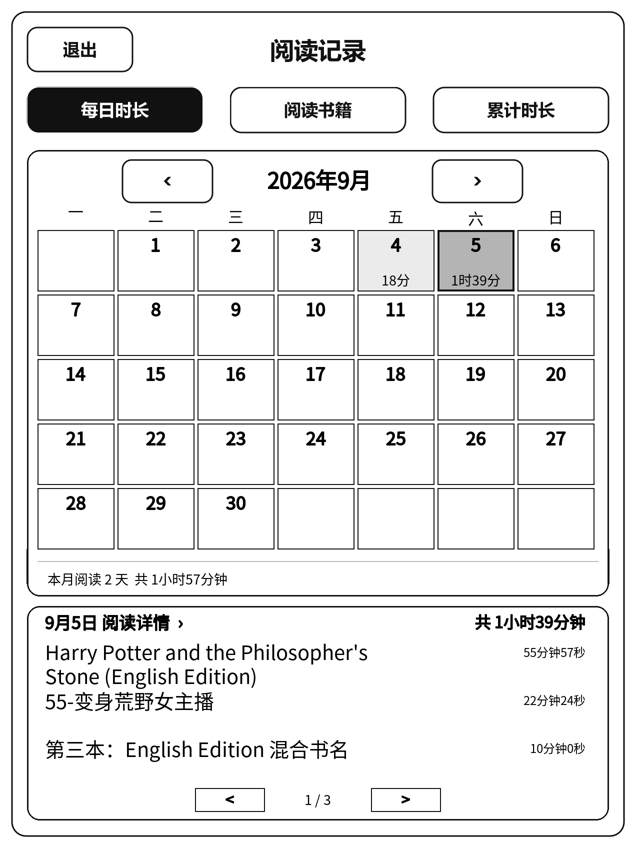
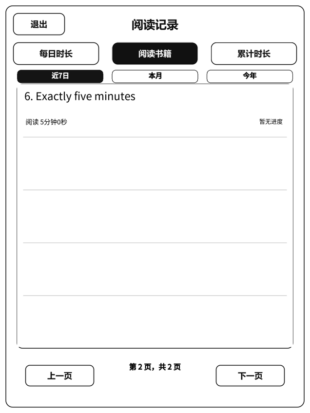
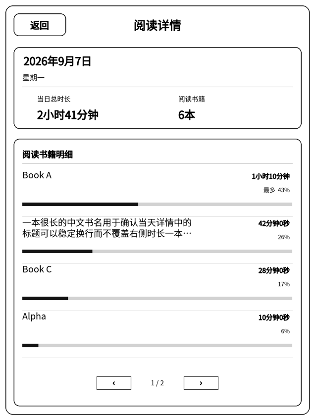

# Kindle 阅读记录

适用于已越狱 Kindle 的本地阅读记录插件。原生阅读器处于前台、屏幕亮起时记录阅读时长，可查看月历热力、每日与累计统计、最近 8 周、阅读书籍、本地封面、月份与单书详情。

当前版本为 **v9.8.1 Standard 普通版**，安装前需已有可用的 **SH Integration 书库脚本支持**。请按固件、越狱方式和机型选择安装包。Kindle Scribe（KS）请查看 v9.7.6 发布页的专用包。

## 安装包选择

| 下载 | 何时选择 |
|---|---|
| **[推荐测试包 · 5.20 Vera · test10](https://github.com/L-1116/kindle-reading-records-enhanced/releases/download/v9.8.1/Kindle-Reading-Records-v9.8.1-5.20-vera-test10-KPW6-Youth-backup.zip)** | KPW6／青春版。已验收 KPW6／5.20.1／Vera；青春版与其他固件小版本目前缺少此构建的完整实测 |
| [5.19 Vera 专用包](https://github.com/L-1116/kindle-reading-records-enhanced/releases/download/v9.8.1/Kindle-Reading-Records-v9.8.1-5.19-vera-519-only.zip) | 已验收 KPW6／5.19.6／Vera；这是独立的 5.19 适配 |
| [KC 备用包 · 5.20 Vera · test11](https://github.com/L-1116/kindle-reading-records-enhanced/releases/download/v9.8.1/Kindle-Reading-Records-v9.8.1-5.20-vera-test11-KC-backup.zip) | Kindle Colorsoft。彩色封面修复已验收，具体 KC 型号与固件小版本未记录 |

> **5.20 Vera 的 test12 因安装兼容性问题暂停分发。** 根据现有反馈，test10 相对稳定，现为 KPW6／青春版的推荐测试包，无法保证所有设备兼容。KC（Kindle Colorsoft）保留 test11 备用包。test10 和 test11 是 v9.8.1 下的测试构建。

## 安装与原地升级

1. **先备份 Kindle 的 `reading-time` 文件夹**，保留阅读历史、配置和封面。
2. 按上表选择 **一个安装 ZIP**，先阅读其中的「安装说明-请先阅读.txt」。
3. **只解压外层 ZIP 一次**，得到 `reading-records-v4-install.sh` 与 `阅读记录安装数据.tar`，将两者一起复制到 Kindle `documents`，覆盖同名安装文件；TXT 留在电脑上即可。**不要继续解压 TAR，不要混用不同包的脚本和 TAR**。
4. 安全弹出 Kindle，在书库点击“安装阅读记录”，等待完成。同一环境下受安装器识别的旧 Standard 普通版可原地升级，无需先卸载。
5. 打开“阅读记录”，确认历史、封面和新增计时正常后，再点击“确认无误之后，再点这个”清理安装文件。

**已成功安装 test12 的设备会触发版本归属保护，无法直接覆盖降级到 test10 或 test11。** 请保留当前安装和数据，切勿手动删除入口或绕过校验。安装失败时保留两份安装文件、原有备份和已有日志。

Assets 提供三个安装 ZIP，内附根目录「安装说明-请先阅读.txt」。test10 沿用原来的下载地址和文件名（`Kindle-Reading-Records-v9.8.1-5.20-vera-test10-KPW6-Youth-backup.zip`）。GitHub 自动生成的 Source code 压缩包仅供查看源码。

[详细安装与回滚](docs/安装与回滚.md) · [v9.8.1 发布页](https://github.com/L-1116/kindle-reading-records-enhanced/releases/tag/v9.8.1) · [其他固件与 Scribe 专用包（v9.7.6）](https://github.com/L-1116/kindle-reading-records-enhanced/releases/tag/v9.7.6)

## v9.8.1 新功能

- **自定义缺失封面**：支持通用替代图片，也可给每本书指定专属图片；已有可用原始封面继续优先使用。历史书籍以双列卡片显示，并标明当前封面来源。
- **新增设置界面**：在插件内管理计时选项和自定义封面。
- **自定义无操作计时上限**：可设置连续多少分钟无操作后暂停计时（1～1440 分钟）；5.20/Vera 当前包支持触摸与蓝牙翻页恢复，5.19/Vera 原包保持原有触摸行为，减少忘记翻页时的误计时；可单独开关。
- **累计时长与阅读书籍 UI 更新**：调整文字、图表和按钮布局；阅读书籍及历史书籍均可点击底部页码直接跳页，历史书籍每页显示 10 本。
- **修复插件界面无法熄屏的问题**，改善停留在插件内时的休眠与恢复行为。

安装完成后，USB 存储中的 `reading-time/custom-covers/` 图片目录即已存在，无需先启动插件或开启封面开关。把 JPG / PNG 图片复制到该目录，再到“设置 → 自定义缺失封面”启用并选择通用或专属图片。自定义封面与无操作暂停计时初始均关闭，已有设置在升级时保留。

## 界面预览（旧版参考）

| 每日时长 | 阅读书籍 | 当天详情 |
|---|---|---|
|  |  |  |

## 使用支持与历史版本

**[遇到问题？使用 AI 自助排查](https://github.com/L-1116/kindle-reading-records-enhanced/blob/main/docs/%E5%AE%89%E8%A3%85%E4%B8%8E%E5%9B%9E%E6%BB%9A.md#遇到问题使用-ai-自助排查)**，可复制提示词，附上设备信息和已有日志。

其他环境请查看 [v9.7.6 原发布页](https://github.com/L-1116/kindle-reading-records-enhanced/releases/tag/v9.7.6)，按该页的固件、越狱方式与安装步骤选择，不将 KPW4 SpringBreak 包扩大为所有 5.18 设备。

遇到问题时保留安装文件和备份，通过 [Issues](https://github.com/L-1116/kindle-reading-records-enhanced/issues) 提供机型、固件、越狱方式、所选安装包及错误现象。普通用户无需执行诊断命令、选择 runtime 或测试二进制。

[更新记录](CHANGELOG.md) · [发布说明与封面用法](docs/releases/v9.8.1.md) · [包来源与校验表](docs/releases/v9.8.1-downloads.md) · [全部历史 Releases](https://github.com/L-1116/kindle-reading-records-enhanced/releases)

## 作者、上游授权与致谢

本项目基于 [Plutoill/kindle-reading-records](https://github.com/Plutoill/kindle-reading-records) 的代码，经原作者明确授权后继续维护。原始工作归 Plutoill，后续增强和维护由 L-1116 完成；本仓库不是上游或 Amazon 的官方版本。

本仓库不附加通用软件许可证，也不应被视为向第三方授予复制、修改或再发布代码的许可；如需复用，请分别联系相关权利人。随包 NotoSansCJK 字体按 SIL Open Font License 1.1 分发，条款见 [FONT-LICENSE.txt](native-reading-time-package/FONT-LICENSE.txt)。
